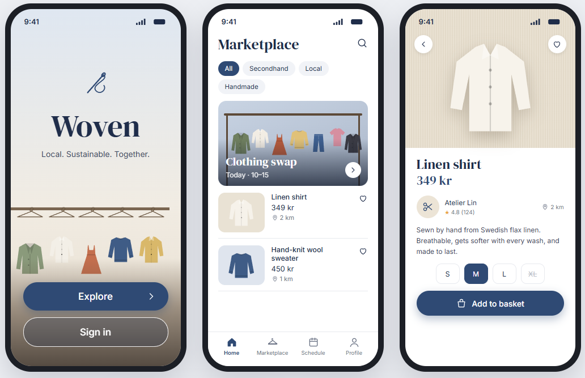

# Design references

Screenshots and mockups the owners like. They are **inspiration for the UX agent, not a spec**.
The current rules live in [`../design-system.md`](../design-system.md); a reference changes them only after the owners
decide (recorded in [`../DECISIONS.md`](../DECISIONS.md)).

How to use them: look at what the reference does well, compare it with our design system and the product principles
(clothing photos are the hero, calm UI, light and dark mode, WCAG AA), and propose concrete directions on an
`agent:ux` issue. Don't copy names, logos or copy text from a reference.

## 2026-11-14: navy + serif mockup

Added by @Yolkem23. "Woven" is just the mockup's name, not ours (our app is Cloey).

What stands out:
- **Colour:** deep navy primary (filled pill buttons, selected chip, selected size), white and soft cream backgrounds,
  light grey-blue and cream photo wells. Garments bring the rest of the colour.
- **Type:** a serif display face for big headings, titles and prices ("Marketplace", "Linen shirt", "349 kr"),
  a clean sans-serif for body text, labels and metadata.
- **Shape:** fully rounded pill buttons and filter chips, rounded cards and photos, round icon buttons over photos
  (back, favourite).
- **Layout:** hero card with a photo and overlaid serif title; list rows with a square photo, title, price and distance;
  detail page with a large photo on top, seller row with rating, size picker, one full-width primary action at the bottom.
- **Navigation:** bottom tab bar with outline icons and labels, selected tab in navy.
- **Photography:** soft, warm, low-contrast, garments on hangers or flat on calm backgrounds.

Open questions for the UX agent: does navy replace clay as the accent, or sit alongside it? Does a serif display
face fit Cloey's tone and stay readable at large text sizes? What is the dark-mode equivalent?
